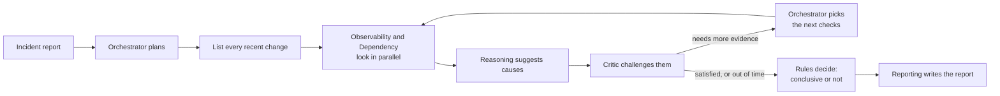

# How it works

## The team

| Agent | Its job |
|---|---|
| Orchestrator | Reads the incident report and decides where to look first |
| Observability | Reads logs and measurements: what broke, where and when |
| Dependency | Checks what changed recently, and which services rely on which |
| Reasoning | Suggests possible causes and ranks them |
| Critic | Questions each cause and asks for missing evidence |
| Reporting | Writes the final report |

## One investigation



1. The orchestrator reads the report and plans two or three lines of enquiry.
2. Before anyone guesses, every change made in at least the hour before the report is listed,
   so nothing is missed.
3. The two specialist agents investigate at the same time, using five tools: search logs,
   read measurements, list changes, show which services depend on which, and search past
   incident reports.
4. The reasoning agent suggests causes, citing what was found.
5. The critic questions them. If it wants more evidence, the orchestrator turns its requests
   into the next round of checks. This repeats up to two rounds.
6. Fixed rules decide whether the answer is conclusive, and the reporting agent writes it up.

These steps, and each agent's own think-and-use-tools loop, are run by
[LangGraph](https://langchain-ai.github.io/langgraph/), an open-source library for
building teams of AI agents.

## The shared notebook

The agents never talk to each other directly. Each one reads a shared notebook and hands
back its findings, and only the program writes them in. While doing so it checks every
piece of evidence: anything that points to data no tool actually returned is thrown out.
This stops an agent from inventing evidence.

## What the AI decides, and what fixed rules decide

| The AI decides | Fixed rules decide |
|---|---|
| Where to look, and what the findings mean | Every recent change is listed before anyone guesses |
| Which causes to suggest, and how sure it is | How sure it is allowed to be: a cause seen only in old incidents, or with no supporting logs or measurements, is held back |
| What the critic objects to | A change made after the problem was reported can't be its cause |
| How the report is worded | Whether the answer is conclusive: confident enough, clearly ahead of the next best cause, and with no unresolved objections |

## When things go wrong

| Problem | What happens |
|---|---|
| A tool is slow or briefly down | It is tried up to three times |
| A tool keeps failing | It is no longer called for the rest of the investigation |
| A tool returns only part of its data | The report lists what was missing |
| The AI service is busy | Everyone waits a little and tries again |
| The AI model keeps failing | The same request goes to a backup model, and the run records which model answered |
| An agent fails | Its work is recorded as missing evidence, and the others carry on |
| Time or budget runs out | A reserve is kept so the report can still be written |

Every investigation ends with a report, even when everything else fails.

## The comparison

To find out whether the team is worth it, a single AI agent does the same job alone, with
the same tools, the same AI model, the same budget and the same rules for deciding. The
only difference is the teamwork.

## Where things are in the code

```
src/investigator/
  agents/         the six agents and their instructions
  investigation/  how one investigation runs, and its fixed rules
  tools/          the five tools, and the failures they can have
  world/          the pretend brokerage and its data
  runtime/        the shared notebook, the budget, and each agent's think-and-use-tools loop
  llm/            talking to the AI model, retries and recordings
  eval/           scoring the results
  ui/             the viewer
  baseline.py     the single-agent comparison
```
